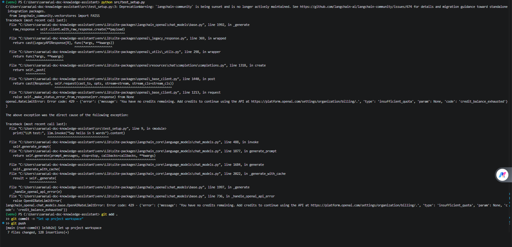

# Baseline Audit Report

**Project:** AI Document Knowledge Assistant & Q&A App
**Author:** Bushra Ashraf, Khadija Malik
**Date:** 12 October 2026

---

## 1. Current Workflow

### How people find answers today
Using the example scenario of Acme Cloud Intelligence, a SaaS startup with
200+ internal product markdown docs and FAQs:

1. The person opens the documentation site or folder.
2. They use keyword search or Ctrl+F across many files.
3. If that fails, they ask a colleague or support.
4. Often they give up or guess.

### Pain points
| Pain point | Impact |
|---|---|
| Keyword search misses answers worded differently | Time wasted, often hours |
| Answers are spread across many files | Hard to combine information |
| No way to verify where an answer came from | Low trust |
| Colleagues get interrupted repeatedly | Lost team productivity |
| Generic AI chatbots do not know the company docs | Wrong or invented answers |

### Opportunity
A RAG assistant can find the relevant parts of the docs by meaning, answer in
plain language, and show citations so the answer can be verified.

---

## 2. Tool Review

| Tool | Role in this project | Limits |
|---|---|---|
| Python | Main programming language for all code | Needs a virtual environment to manage packages |
| LangChain | Connects document loading, splitting, embeddings, retrieval and the LLM | Library changes often, so versions must be pinned |
| OpenAI API | Creates embeddings and generates answers | Costs money per use, needs internet, adds response delay |
| FAISS | Stores embeddings and finds similar chunks quickly | Runs in memory, no built-in database features, saved manually |
| Streamlit | Builds the web interface for asking questions | Simple layout, not meant for very large production apps |

### Proof the tools work
I ran `src/test_setup.py`, which made an OpenAI chat call and built a small
FAISS index. Both worked.

### Environment
- Python version: (run `python --version` and write it here)
- Key packages: see `requirements.txt`

---

## 3. Decisions

| Decision | Choice | Reason |
|---|---|---|
| Vector store | FAISS | It is fast and simple for a few hundred documents and needs no extra server. |
| Framework | LangChain | It has ready-made tools for loading, splitting and retrieval, and it has the largest community and examples. |
| LLM and embeddings | OpenAI API | It gives high-quality answers and embeddings with a simple setup. |
| Interface | Streamlit | It lets me build a working web app in pure Python quickly. |

---

## 4. Summary
The current process wastes time and gives no verifiable sources. The tools
above are installed and tested, and are suitable for building a cited
document Q&A assistant in the following weeks.